# تقرير الاختبارات — Test report

كل الاختبارات أدناه نُفّذت آليًا على **Minecraft Forge 1.12.2-14.23.5.2860 حقيقي** (Java 8): سيرفر مخصص (dedicated server)، وعميل Minecraft حقيقي يعمل دون شاشة (Xvfb + Mesa llvmpipe OpenGL 4.5) في وضع اللعب الفردي (integrated server) واللعب الجماعي (متصل بالسيرفر عبر الشبكة). المود المُختبر هو ملف `build/libs/UltraRealisticWaterPhysics-1.12.2-1.0.0.jar` نفسه (بعد إعادة التعمية إلى أسماء SRG) موضوعًا في مجلد `mods`.

- السيرفر: **49/49** فحصًا ناجحًا — `tests/test_server.py`
- العميل (فردي + جماعي): **17/17** فحصًا ناجحًا — `tests/test_client.py`
- اختبار الحفظ المتكرر (3 إعادات تشغيل والماء يتحرك): **6/6** — `tests/test_persistence.py`

طريقة القياس: كل سيناريو يُبنى بأوامر حقيقية (`/fill`, `/setblock`) واستخدام الدلو يتم عبر كود الدلو الأصلي في Minecraft (لاعب وهمي على السيرفر، ويد اللاعب الحقيقي في العميل). القياسات من الأمر `/water` (مخرجات key=value)، والمعدلات محسوبة بعدد tick السيرفر (20 tick = 1 ثانية) فلا يؤثر بطء الجهاز على النتائج. السجلات الكاملة في `tests/results/` (ملفات .log تُنشأ عند التشغيل).

## الحالات التسع المطلوبة

| # | الحالة | النتيجة |
|---|---|---|
| 1 | وضع دلو ماء على الأرض | ✅ (5 فحوص) |
| 2 | ملء خزان بالمياه | ✅ (6 فحوص) |
| 3 | ثقب جدار الخزان | ✅ (6 فحوص) |
| 4 | خروج المياه من الثقب | ✅ (6 فحوص) |
| 5 | انخفاض مستوى المياه | ✅ (6 فحوص) |
| 6 | اختلاف سرعة التسرب حسب حجم الثقب | ✅ (6 فحوص) |
| 7 | إغلاق الثقب | ✅ (6 فحوص) |
| 8 | توصيل خزانين بأنبوب | ✅ (4 فحوص) |
| 9 | إعادة تشغيل العالم والتأكد من حفظ حالة المياه | ✅ (11 فحوص) |

## نتائج السيرفر المخصص (Dedicated server)

| الاختبار / Test | الفحص / Check | النتيجة | القياس الفعلي / Measured |
|---|---|---|---|
| 1 bucket on the ground | vanilla bucket item used through the bucket event | ✅ PASS | bucket mode=empty result=SUCCESS item=minecraft:bucket |
| 1 bucket on the ground | exactly 1000 L placed in the world | ✅ PASS | volume=999.993 L in 50 blocks |
| 1 bucket on the ground | water spread over the ground (not a single block) | ✅ PASS | 50 blocks wet, surface y=4.032 |
| 1 bucket on the ground | empty bucket picks up exactly 1000 L again (mass conserved) | ✅ PASS | pickup: bucket mode=fill result=SUCCESS item=minecraft:water_bucket; remaining=0.000 L |
| 1 bucket on the ground | no water can be taken from nothing (no infinite water) | ✅ PASS | bucket mode=fill result=FAIL item=minecraft:bucket |
| 2 fill a 10000 L tank with buckets | tank capacity detected | ✅ PASS | tank pos=1352,5,-755 capacity_l=10000 closed=false spill=10 floor=5 volume_l=0.000 |
| 2 fill a 10000 L tank with buckets | 9 buckets = exactly 9000 L in the tank (nothing lost) | ✅ PASS | volume=8999.996 L, surface y=9.512 |
| 2 fill a 10000 L tank with buckets | 10th bucket fills the 10000 L tank to the brim (>= 99.5 %) | ✅ PASS | inside=9999.99 L, splashed over the rim=0.00 L, surface y=10.000 |
| 2 fill a 10000 L tank with buckets | all 10000 L accounted for (inside + spilled) | ✅ PASS | total=9999.994 L |
| 2 fill a 10000 L tank with buckets | hydrostatic pressure at the bottom ~ rho*g*h (5 m -> ~49 kPa) | ✅ PASS | bottom pressure=49.05 kPa |
| 2 fill a 10000 L tank with buckets | an 11th bucket overflows: the tank stays full, the excess spills out | ✅ PASS | inside=9888.4 L, outside=1111.4 L, total=10999.80 L |
| 3-5,7 hole in a tank wall | tank filled | ✅ PASS | volume=80000.0 L surface=10.000 |
| 3-5,7 hole in a tank wall | 3) breaking a wall block creates a hole: water starts leaving | ✅ PASS | V: 80000 -> 55439 L |
| 3-5,7 hole in a tank wall | 4) water flows out through the hole onto the ground | ✅ PASS | outside=22146 L in 212 blocks |
| 3-5,7 hole in a tank wall | 5) the level inside decreases gradually (monotonic) | ✅ PASS | surface 10.000 -> 8.576; samples=11 |
| 3-5,7 hole in a tank wall | outflow follows Torricelli (Q/sqrt(h) roughly constant) | ✅ PASS | Q/sqrt(h): mean=1635 L/s/m^0.5, spread=3%, ideal free orifice=2746; samples (h m, Q L/s): (4.50, 4014), (4.50, 3417), (4.36, 3396), (4.13, 3333), (3.94, 3239), (3.77, 3175), (3.61, 3110), (3.44, 3065), (3.29, 2985), (3.15, 2915) |
| 3-5,7 hole in a tank wall | 7) closing the hole stops the leak | ✅ PASS | after closing: 53655.48 L -> 53655.47 L in 5 s |
| 6 leak speed depends on hole size | bigger hole drains faster (2 m^2 > 1 m^2 > 100 cm^2 > 20 cm^2) | ✅ PASS | 1 block hole (1 m^2): 3345.3 L/s, 2 block hole (2 m^2): 5970.6 L/s, spigot 100 cm^2: 58.2 L/s, spigot 20 cm^2: 11.6 L/s |
| 6 leak speed depends on hole size | 2 m^2 hole drains about twice as fast as 1 m^2 (ratio 1.4..2.6) | ✅ PASS | ratio=1.78 |
| 6 leak speed depends on hole size | small orifices follow area ratio 100/20 = 5 (ratio 4..6) | ✅ PASS | ratio=4.99 |
| 6 leak speed depends on hole size | spigot flow matches Torricelli Q = Cd*A*sqrt(2gh) (within 25%) | ✅ PASS | measured 58.17 L/s, theory 58.26 L/s |
| 6b several holes share the outflow by depth | the deeper hole leaks faster (higher pressure) | ✅ PASS | low hole 64.25 L/s, high hole 43.19 L/s |
| 6b several holes share the outflow by depth | flow ratio matches Torricelli sqrt(h_low/h_high) within 10% | ✅ PASS | ratio=1.488 expected=1.486 (h_low=5.48 m, h_high=2.48 m) |
| tank gauge + comparator | comparator reads the fill level from the gauge (50 %% -> signal 7..8) | ✅ PASS | tank 18000.000 / 36000 L, comparator signal=8 |
| bucket poured into a pipe | water poured into a funnel on a pipe flows down and fills the pipe | ✅ PASS | bucket mode=empty result=SUCCESS item=minecraft:bucket; pipe contents bottom..top = 50.0, 50.0, 49.4 L (capacity 3 x 49.1 L) |
| bucket poured into a pipe | funnel + pipe contents = the 1000 L poured | ✅ PASS | funnel 850.66 L + pipe 149.39 L = 1000.05 L |
| vanilla water interaction | disturbed vanilla water becomes physical water and flows into the trench | ✅ PASS | trench holds 16974 L in 18 blocks (surface y=3.89); converted 6000 L |
| vanilla water interaction | the undisturbed lake acts as a reservoir: it refills the trench to its own level | ✅ PASS | net inflow from the lake 16629 L, trench surface y=3.89, lake surface y=3.89 |
| vanilla water interaction | reservoir exchange is accounted (mass ledger balanced) | ✅ PASS | drift=-1.029 L |
| 8 two tanks connected by a pipe | initial: tank A full of water, tank B empty | ✅ PASS | A=35094 L (surface 9.00) B=207 L |
| 8 two tanks connected by a pipe | water flows through the pipe from A to B | ✅ PASS | B received 17321 L; initial flow 491 L/s |
| 8 two tanks connected by a pipe | levels equalise (communicating vessels) | ✅ PASS | surface A=6.966 B=6.925 after 84 s |
| 8 two tanks connected by a pipe | total water conserved (A + B + pipe contents = poured amount) | ✅ PASS | A+B+pipes=36000.75 L vs poured 36000.00 L (pipes hold 988.1 L) |
| valve controls the flow | closed valve: no flow between the tanks | ✅ PASS | B: 17312 -> 17313 L while A=35674 L |
| valve controls the flow | opened valve: flow resumes | ✅ PASS | B: 17313 -> 18832 L |
| pump lifts water to a higher tank | water is pumped up 7 m into the upper tank | ✅ PASS | upper tank=812 L (surface 12.12), pump flow=47.462 L/s |
| pump lifts water to a higher tank | source tank loses what the upper tank gains (+ pipe contents) | ✅ PASS | source -956 L, upper +812 L |
| over-pressure: pipes crack and fragile pipes burst | pump against a closed valve builds pressure above the glass rating (60 kPa) | ✅ PASS | max pressure seen=211.0 kPa |
| over-pressure: pipes crack and fragile pipes burst | the fragile glass pipe bursts and releases its water | ✅ PASS | glass pipe position now: waterphysics:water |
| over-pressure: pipes crack and fragile pipes burst | copper pipe (rated 800 kPa) survives the same pressure | ✅ PASS | copper damage=0.000 at 0.510 kPa |
| over-pressure: pipes crack and fragile pipes burst | a cracked pipe leaks water into the world | ✅ PASS | water in the basin around the pipe: 310.3 -> 581.2 L (18 blocks); pipe at 88.806 kPa |
| mass conservation | stored water = sum(in) - sum(out) over the whole session | ✅ PASS | drift=-6.087 L of 519719 L total (rounding -77.1140 L) |
| performance | server tick cost of the simulation | ✅ PASS | last tick 10.032 ms, 37 active sections, 23 pipe nodes |
| 9 restart persistence | water volume of a draining tank is preserved across restart | ✅ PASS | before stop=44946.4 L, after restart=44931.9 L |
| 9 restart persistence | the leak continues after restart (simulation state restored) | ✅ PASS | 44931.9 -> 44861.5 L in 6 s |
| 9 restart persistence | connected tanks keep their water (A+B) | ✅ PASS | A+B 52965 -> 52927 L (A 28387->27896, B 24577->25031) |
| 9 restart persistence | pipe contents are saved | ✅ PASS | pipe 197.81 -> 197.085 L |
| 9 restart persistence | mass accounting survives restart | ✅ PASS | drift=-48.864 L of 519676 L |
| stability | no exceptions from the mod in the server logs | ✅ PASS | 0 error lines |

## نتائج العميل (Singleplayer + Multiplayer)

| الاختبار / Test | الفحص / Check | النتيجة | القياس الفعلي / Measured |
|---|---|---|---|
| singleplayer (integrated server) | client started, world created, scenario completed without crash | ✅ PASS | log lines=975 crashed=False |
| singleplayer (integrated server) | player right-clicks with a water bucket: bucket becomes empty | ✅ PASS | use -> SUCCESS; held item=minecraft:bucket count=1 |
| singleplayer (integrated server) | the bucket placed exactly 1000 L of physical water | ✅ PASS | region: 999.990 L |
| singleplayer (integrated server) | tank filled (60000 L + displaced puddle), leak lowers the level, closing the hole stops it | ✅ PASS | full=60187 after leak=53693 -> 51100; closed: 51602.1 -> 51602.1 |
| singleplayer (integrated server) | pump pushes water up into glass pipes | ✅ PASS | pump flow=53.051 L/s, glass pipe holds 51.101 L |
| singleplayer (integrated server) | client receives physics detail packets from the (integrated) server | ✅ PASS | client stats packets=71 sections=4 activeSections=4 overlayCells=151 particles=18 fps=12 entityParticles=379; client stats packets=118 sections=7 activeSections=7 overlayCells=289 particles=14 fps=25 entityParticles=85; client stats packets=148 sections=7 activeSections=7 overlayCells=322 particles=3 fps=27 entityParticles=185; client stats packets=161 sections=7 activeSections=7 overlayCells=330 particles=8 fps=24 entityParticles=184 |
| singleplayer (integrated server) | wave/ripple overlay rendered on moving water | ✅ PASS | overlay cells per frame: [151, 289, 322, 330] |
| singleplayer (integrated server) | mass conservation in singleplayer | ✅ PASS | drift=-0.049 L of 136033.597 L |
| singleplayer (integrated server) | no exceptions from the mod in the client log | ✅ PASS | 0 lines |
| singleplayer (integrated server) | all mod models and textures load | ✅ PASS | 0 model/texture errors |
| singleplayer (integrated server) | screenshots captured | ✅ PASS | sp_02_tanks_full.png, sp_03_leak_jet_a.png, sp_04_leak_jet_b.png, sp_05_leak_spreading.png, sp_06_vortex_a.png, sp_07_vortex_b.png, sp_08_pump_pipes.png, sp_09_hydrometer_hud.png, sp_10_settings_gui.png |
| multiplayer (dedicated server + client) | server side: the tank leaks while a client is connected | ✅ PASS | tank volume now 22520 L |
| multiplayer (dedicated server + client) | client connects to the dedicated server (mod handshake ok) | ✅ PASS | joined=True |
| multiplayer (dedicated server + client) | client receives physics sync packets over the network | ✅ PASS | client stats packets=47 sections=5 activeSections=5 overlayCells=266 particles=12 fps=25 entityParticles=169; client stats packets=60 sections=5 activeSections=5 overlayCells=300 particles=4 fps=25 entityParticles=144; client stats packets=70 sections=5 activeSections=5 overlayCells=328 particles=3 fps=28 entityParticles=95 |
| multiplayer (dedicated server + client) | client renders effects from synced data (overlay cells > 0) | ✅ PASS | overlay cells: [266, 300, 328] |
| multiplayer (dedicated server + client) | screenshots captured | ✅ PASS | mp_01_leak.png, mp_02_leak_later.png |
| multiplayer (dedicated server + client) | no exceptions from the mod (client and server) | ✅ PASS | 0 lines |

## اختبار الحفظ المتكرر

| الاختبار / Test | الفحص / Check | النتيجة | القياس الفعلي / Measured |
|---|---|---|---|
| persistence stress (3 restarts while water moves) | restart 1: world-wide mass audit balanced | ✅ PASS | drift=0.002 L of 239999.933 L (loaded 239999.933, unloaded 0.000, pipes 0.000) |
| persistence stress (3 restarts while water moves) | restart 1: water still moving after reload | ✅ PASS | active sections=16 |
| persistence stress (3 restarts while water moves) | restart 2: world-wide mass audit balanced | ✅ PASS | drift=-0.010 L of 239999.892 L (loaded 239999.892, unloaded 0.000, pipes 0.000) |
| persistence stress (3 restarts while water moves) | restart 2: water still moving after reload | ✅ PASS | active sections=24 |
| persistence stress (3 restarts while water moves) | restart 3: world-wide mass audit balanced | ✅ PASS | drift=-0.014 L of 239999.867 L (loaded 239999.867, unloaded 0.000, pipes 0.000) |
| persistence stress (3 restarts while water moves) | restart 3: water still moving after reload | ✅ PASS | active sections=27 |

## لقطات الشاشة (من العميل الحقيقي أثناء الاختبار)

**لعب جماعي: العميل يعرض تسرب خزان يحاكيه السيرفر** — `mp_01_leak.png`

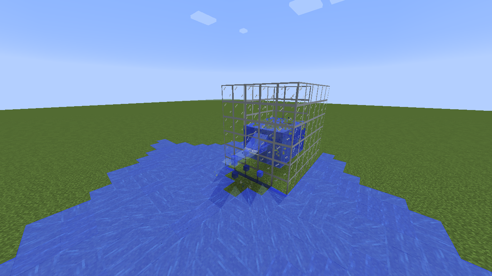

**لعب جماعي: بعد ثوانٍ** — `mp_02_leak_later.png`

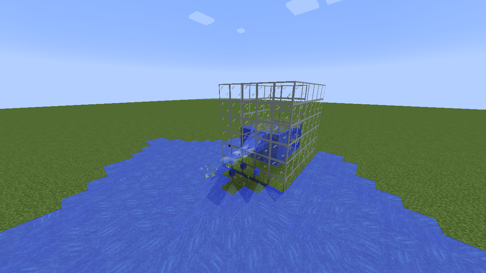

**sp_01_bucket_on_ground.png** — `sp_01_bucket_on_ground.png`

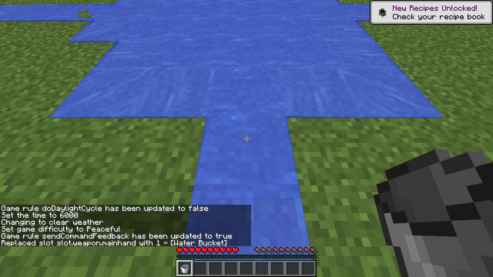

**خزانات زجاجية ممتلئة + بركة الدلو على الأرض** — `sp_02_tank_full.png`

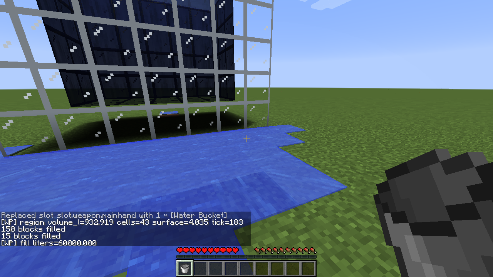

**خزانات زجاجية ممتلئة + بركة الدلو على الأرض** — `sp_02_tanks_full.png`

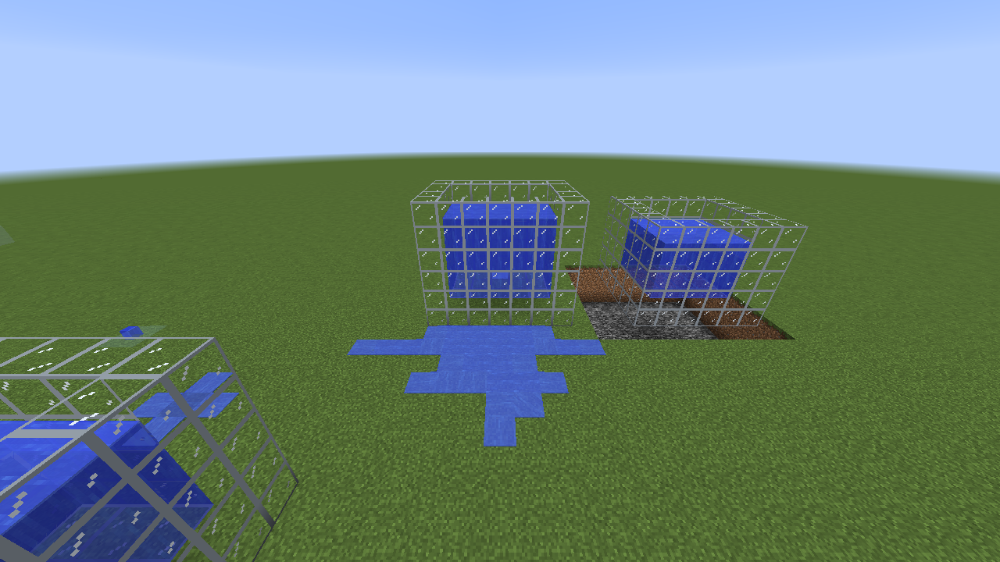

**لحظة فتح ثقب في جدار الخزان: تيار ماء ساقط ورذاذ** — `sp_03_leak_jet_a.png`

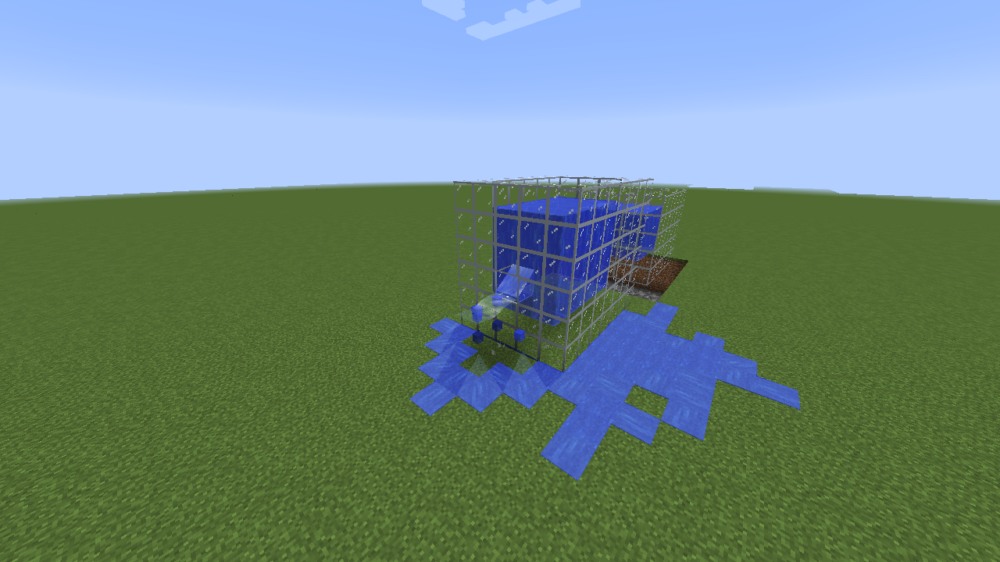

**استمرار التسرب: انتشار الماء على الأرض** — `sp_04_leak_jet_b.png`

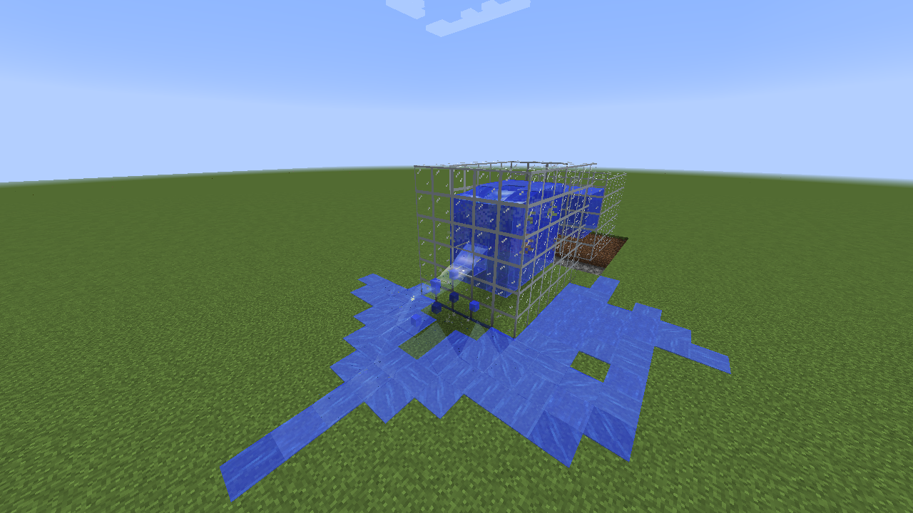

**المستوى ينخفض والماء ينتشر حسب التضاريس** — `sp_05_leak_spreading.png`

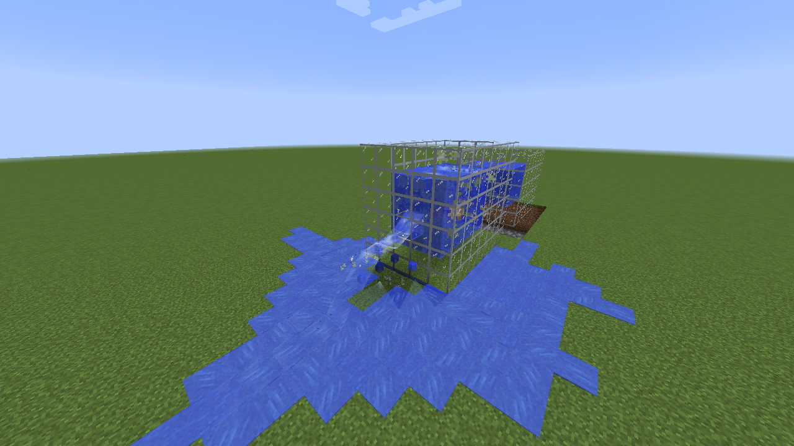

**مصرف في أرضية خزان: بداية الدوامة** — `sp_06_vortex_a.png`

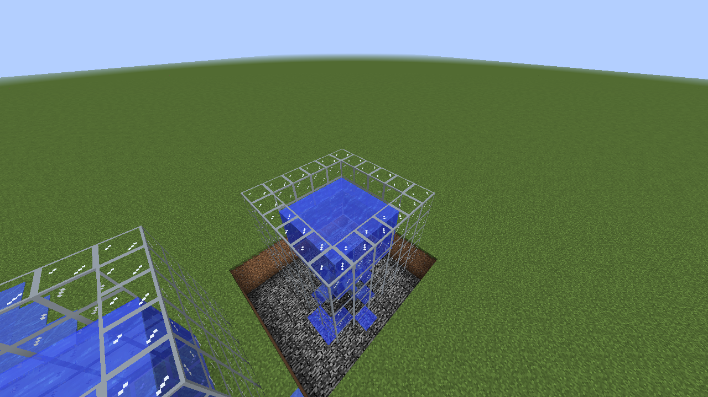

**الدوامة: فقاعات تدور نحو المصرف وعمود ماء ساقط** — `sp_07_vortex_b.png`

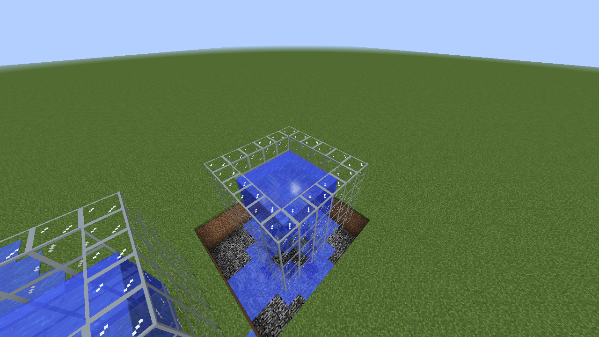

**مضخة ترفع الماء في أنبوب زجاجي (الماء ظاهر داخل الأنبوب) ويخرج من طرفه** — `sp_08_pump_pipes.png`

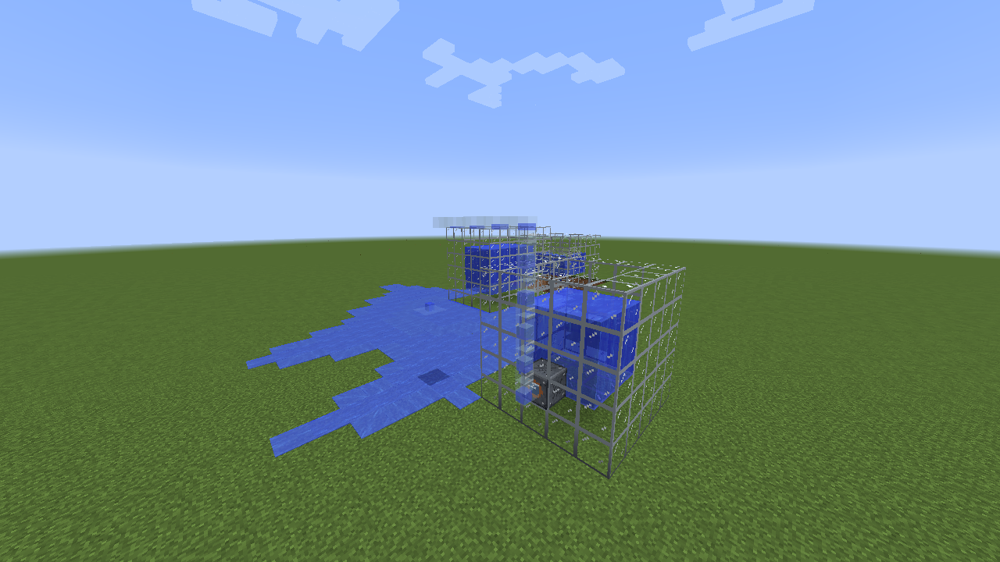

**شاشة مقياس المياه: الحجم، المستوى، الضغط، السرعة** — `sp_09_hydrometer_hud.png`

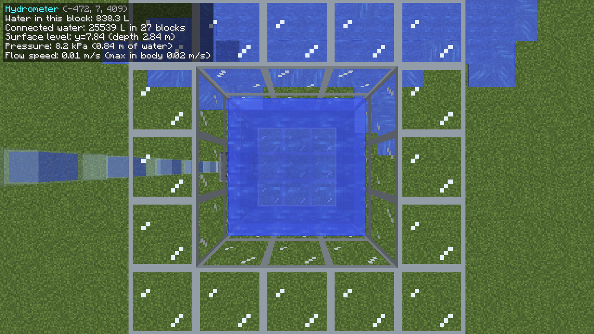

**واجهة الإعدادات داخل اللعبة** — `sp_10_settings_gui.png`

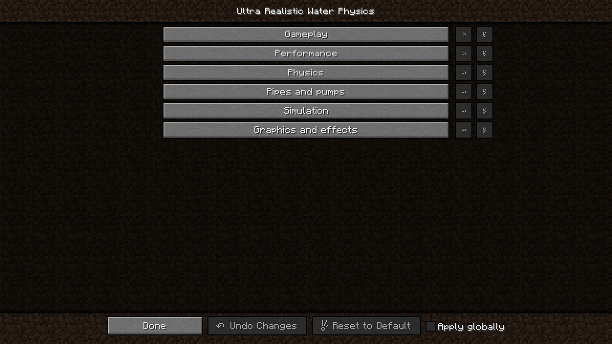

## ملاحظات صريحة

- الأصوات غير متاحة في بيئة الاختبار (لا يوجد جهاز صوت) — لم تُختبر الأصوات.
- الأداء مُقاس على 4 أنوية دون كرت شاشة (رسم برمجي llvmpipe)، لذلك أرقام FPS في العميل منخفضة ولا تمثل جهازًا حقيقيًا.
- لم يُختبر مع OptiFine أو shaders أو مودات أخرى.

